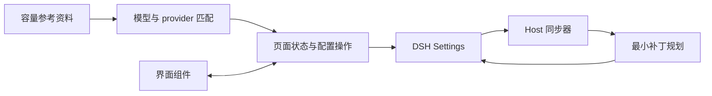

# Contributing

感谢参与 `dsh-model-context-catalog`。

## 开发环境

- Node.js `>= 22`
- npm
- DeepSeek Harness `0.2.0-rc.2`（当前验证基线）

```bash
npm install
npm run check
npm test
npm pack --dry-run
```

`npm run check` 会重新生成 `lib/`、验证构建产物和包边界，并递归检查源码语法及格式。`npm run format` 可统一代码格式。
提交前必须保证全部命令通过。

## 代码结构

| 目录 | 职责 |
| --- | --- |
| `src/host/` | DSH 插件入口、Config 表单和上下文同步；revision 冲突在同步器内处理 |
| `src/domain/` | 管理条目、容量校验和最小配置补丁规划，不依赖界面或 DSH 运行时 |
| `src/discovery/` | provider 别名、模型名称匹配、候选筛选、确认前核对及内置目录读取 |
| `src/data/` | models.dev 数据规范化与容量参考快照 |
| `src/client/components/` | 模型选择器、批量预览和设置页渲染 |
| `src/client/controller.js` | 页面状态、手动保存、全选后的批量确认与失败提示 |
| `src/client/models.js`、`settings.js` | 模型展示数据和条目 mutation 规划 |
| `src/client/styles.css`、`styles.js`、`locales.js` | 样式安装和中英文文案 |
| `src/shared/` | 路由键、容量校验和 DSH 服务名称 |
| `scripts/` | 构建、递归 lint、资料更新及发布包检查 |
| `test/` | 业务、Host、UI 和包契约回归测试 |
| `lib/` | 由 esbuild 生成的发布产物，DSH 实际加载此目录 |



请修改 `src/`，不要直接编辑 `lib/`。provider 别名集中维护在 `src/discovery/providers.js`；容量资料通过更新脚本生成，不手改快照。

构建入口映射维护在 `scripts/build-source.mjs`。esbuild 按模块依赖打包，浏览器产物不包含 Host 代码或第二份 React；React 仍由 DSH 的模块加载器提供。公开的 `lib/index.js`、`lib/catalog.js` 和 `lib/client.js` 入口保持稳定。

## 贡献规则

### 路由与容量

- 新安装的管理目录必须为空；参考快照只能生成候选，用户勾选确认前不得写入。保留已有条目和启停状态。
- 设置页以启用开关控制管理，仅在同步或写入异常时提示；编辑内容不能改变启停状态。
- 使用精确的 `(provider, model)` 路由，不把不同网关视为同一部署。
- `contextWindow` 必须是正安全整数，并有服务商文档或实际部署证据。
- 不得把 262,144 的 adapter fallback 当成真实容量。
- 同步时必须保留名称、endpoint、协议、凭据引用和其他未知字段。
- 当前不维护 `maxTokens`。
- 中转站容量必须来自该中转站部署；不跨 provider 套用原厂上限。
- 同步只能修改已存在的显式 `models[]` 行，不合成内置目录或 `modelOverrides`。
- DSH 0.2 使用导出的 volatile `Config` 和 `settings.describe/mutate`；不得重新使用旧 `settings.register/get`。
- 客户端表单通过 `configForms.get` 共享，插件不能自行 dispose 共享表单。

### 自动补全

- 只扫描显式配置的模型，不添加未配置路由，不重新启用已有停用条目。
- DSH provider-only discovery 核对内置窗口时不传 API 地址或凭据，禁止回退为自动请求中转站端点。
- 大小写和日期后缀可匹配；主要版本、flash/mini/thinking 等语义差异不得丢弃。
- 精确匹配未命中时，允许根据模型系列、型号和版本信息匹配乱序名称及路由标签；缺少版本时必须能确定唯一型号，不能因容量相同合并不同型号。推测候选不得默认勾选。
- provider 标识或展示名称命中时使用对应服务商记录，否则只使用 models.dev 的独立模型目录默认值，不合并不相关服务商的容量。
- 必须区分模型厂家和服务商，容量选项与保存的来源必须对应；单一容量直接展示，多个选项注明来源。
- 已有不同值必须用户确认；模型默认值仅是自定义部署的参考。
- 已配置窗口、DSH 内置窗口和服务商默认窗口也可纳入管理，默认保留当前值，不自动勾选；无公开参考资料时仍可使用已有容量，不伪造来源链接。
- 只排除已经存在的管理条目，包括停用条目；删除条目后，保留窗口的路由必须能够重新添加。
- 自动补全只使用完整上下文窗口字段；不提供输入上限或输出上限选项。
- 批量确认前重新核对路由与条目，CAS 失败不得报告成功。
- 通过 `node scripts/update-model-capacities.mjs` 更新快照，再构建和测试；记录来源、时间和 SHA-256。

### 模型选择器

- 新建列表只来自 resolved `llm-pi-ai` 中已经配置的模型。
- 不合成不存在的路由。
- `model.name` 必须原样显示；仅在缺失时回退到 `model.id`。
- 不得删除或改写 `(Agent Plan)` 等后缀。
- 保持 provider displayName、provider key、搜索、键盘和 ARIA 行为可用。

### 测试

任何行为变化都需要对应回归测试。特别需要保护：

- 精确路由匹配；
- revision 冲突重试、模型数组重排与逐字段 mutation；
- DSH 真实 SettingsForms 的联动与秘密字段保留；
- 客户端写入返回 false 时不得显示保存成功；
- 模型名称忠实显示；
- 构建产物与源码同步；
- npm 包文件边界。

## 文档分工

- `README.md`：解决的问题、安装和使用方法
- `CONTRIBUTING.md`：开发流程与维护约束
- `CHANGELOG.md`：版本变化和 Release Notes

文档应简洁，避免在多个文件重复同一段内容。

## Pull Request 检查清单

- [ ] 变更范围单一且说明清楚
- [ ] `npm run check` 通过
- [ ] `npm test` 通过
- [ ] `npm pack --dry-run` 只包含预期文件
- [ ] 行为变化有测试
- [ ] 用户可见变化已更新 README 或 CHANGELOG

