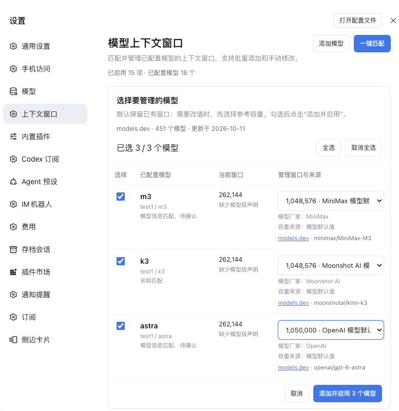
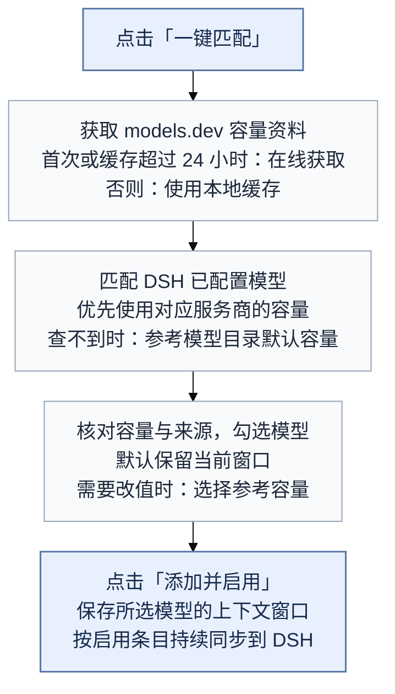
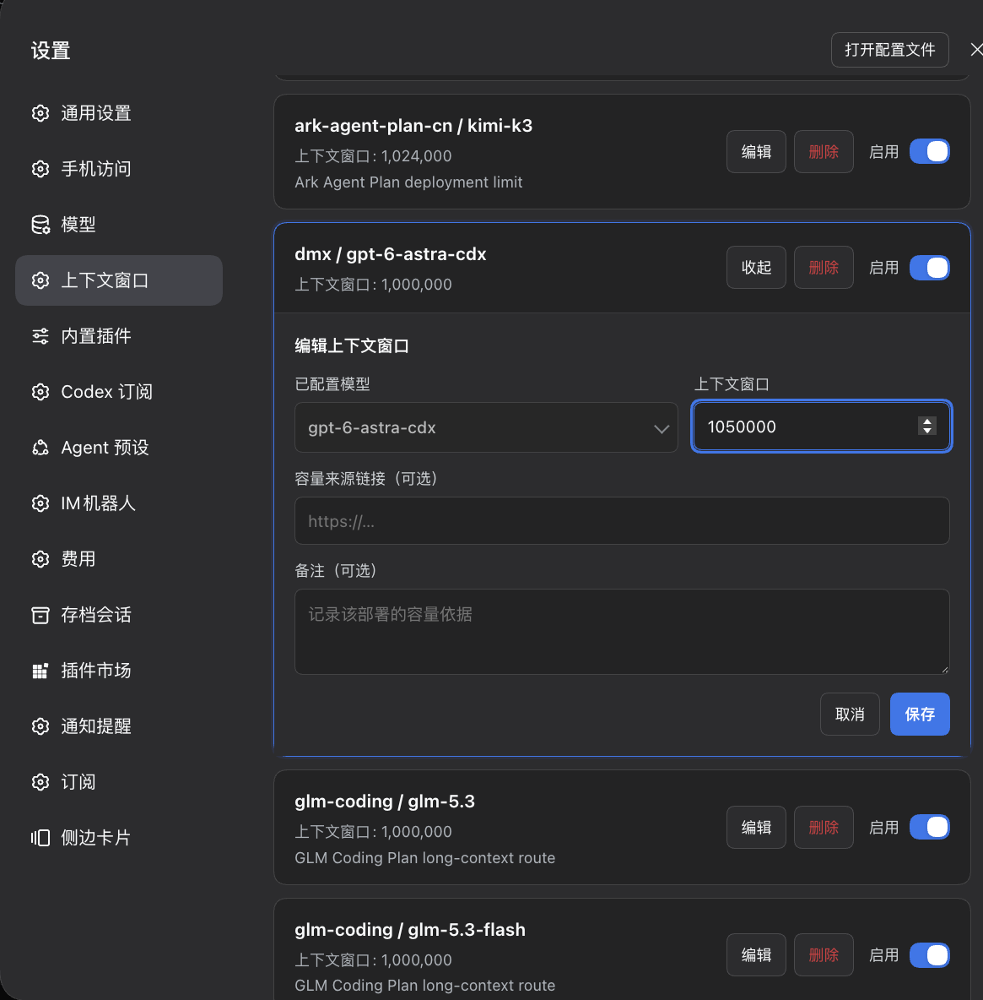

<a id="top"></a>

<div align="center">
<h1>Model Context Catalog</h1>

[](https://www.npmjs.com/package/dsh-model-context-catalog)
[](https://www.npmjs.com/package/dsh-model-context-catalog)
[](https://github.com/HOWILLMAKEIT/dsh-model-context-catalog/actions/workflows/ci.yml)
[](https://github.com/deepseek-ai/deepseek-harness)
[](https://awesome-dsh-plugin.com/zh/p/HOWILLMAKEIT/dsh-model-context-catalog/)
[](https://github.com/router-for-me/CLIProxyAPI)
[](./LICENSE)

**一键匹配模型上下文，勾选后批量配置。**

[主要功能](#主要功能) · [一键匹配](#一键匹配模型上下文) · [手动管理](#手动管理) · [匹配规则](#匹配与容量来源) · [开发](#开发)
</div>

`dsh-model-context-catalog` 是 DSH 的模型上下文配置插件。点击 **一键匹配**，即可为模型目录中已添加的模型查找上下文容量，查看模型厂家、服务商与资料来源，勾选后批量配置，省去逐个查询和填写的工作。

**已有上下文窗口的模型也能纳入管理。** 默认保留当前值；需要改值时，可选择参考容量或手动填写。添加后可以集中编辑、启停和持续同步。

## 主要功能

<p align="center">
  
</p>

| 功能 | 你可以做什么 |
| --- | --- |
| **一键匹配模型上下文** | 扫描 DSH 已配置模型，自动查找上下文窗口及容量来源 |
| **勾选后批量配置** | 逐项勾选或全选，确认后一次添加所选模型并启用管理 |
| **CLIProxyAPI 容量获取** | 从已配置的 CLIProxyAPI 接口读取模型上下文容量，按模型 ID 匹配并展示来源 |
| 自动获取容量资料 | 点击一键匹配时自动获取 models.dev 资料，涵盖 GPT、Claude、Gemini、DeepSeek、GLM、Qwen Coder、Kimi、MiniMax 等系列；缓存 24 小时，过期自动更新 |
| 服务商容量匹配 | 优先使用对应服务商的容量；未命中时使用模型目录默认值，并展示来源链接 |
| 模型名称与别名匹配 | 支持 `k3`、`m3` 等短名称、`astra-gpt` 等乱序名称，以及大小写、分隔符、服务商前缀和日期后缀 |
| 管理已有窗口 | 已填写窗口或使用 DSH 内置窗口的模型也能添加，默认保留当前容量 |
| 手动编辑与持续同步 | 手动添加、修改窗口、记录来源和备注；按启用条目持续同步模型配置 |

安装后，点击 **一键匹配** 查看候选；点击 **添加并启用 N 个模型** 才会保存所选条目并同步窗口。

## 工作方式



插件通过 DSH 原生配置接口同步已有模型的 `contextWindow`，保留模型名称、API 地址、凭据、协议和输出上限。每个 provider / model 路由独立管理，同名模型在不同服务商下可以使用不同窗口。

## 安装与使用

### 安装

需要 DSH 0.2 系列与 Node.js 22 或以上版本。

```bash
dsh plugin --profile web add dsh-model-context-catalog
```

在 DSH 插件管理器中确认插件已启用。若尚未加载，重启 DSH 并刷新 Web 页面。

### 一键匹配模型上下文

1. 先在 DSH **模型设置**中添加服务商和模型，配置好 API 地址、调用协议与凭据。
2. 打开 **设置 → 上下文窗口 → 一键匹配**。
3. 查看当前窗口、可选容量与来源，选择要使用的容量，再勾选需要管理的模型。
4. 点击 **添加并启用 N 个模型**，批量保存并同步到 DSH 模型配置。

| 模型当前的情况 | 如何添加 |
| --- | --- |
| 当前窗口未声明 | 使用匹配到的参考容量；模型 ID 匹配明确且只有一个参考值时，默认勾选 |
| 已有上下文窗口 | 默认保留当前值，勾选即可纳入管理；需要改值时，在下拉栏选择参考容量 |
| 没有公开资料，但已有窗口 | 直接使用现有窗口添加，来源标为当前配置 |
| 没有公开资料，也没有窗口 | 点击 **手动填写**，输入容量后保存 |

下拉选项会注明服务商或模型厂家；有多个参考值时，由你选择。**全选**会勾选已有可选容量的模型。模型配置在预览期间发生相关变更时，页面会提示重新匹配。

已由插件管理的模型不重复添加，包括停用条目。**删除条目后，模型原有窗口仍保留，再次点击一键匹配即可重新添加。**

### 自动获取 CLIProxyAPI（CPA）提供的模型容量

[CLIProxyAPI（CPA）](https://github.com/router-for-me/CLIProxyAPI) 是一款模型 API 代理软件，可以接入 Claude、Gemini、Codex 等渠道，并通过模型列表接口提供上下文容量。

点击 **一键匹配**，插件读取 DSH 中已配置服务商的 `baseURL`，通过服务端使用已有凭据和请求头，发送 `GET {baseURL}/models?client_version=1` 请求。查询用于 OpenAI Completions 和 Responses 路由；协议未填写时按 OpenAI Completions 查询。每个服务商查询一次。

插件将响应中的 `models[].slug` 与该服务商下已配置的模型 ID 精确匹配，读取 `context_window` 作为上下文容量；该字段缺失或无效时，使用 `max_context_window`。匹配结果展示在容量下拉框中，来源标为 **CLIProxyAPI**。

- 同时按模型名称匹配 models.dev 资料，将两种来源的容量一起展示。
- 已有窗口默认保留；尚未设置窗口时，优先推荐 CLIProxyAPI 返回的容量。两种来源容量不同时，可以在下拉框中选择。
- 接口查询失败或没有可用容量时，使用 models.dev 资料和当前配置。
- 点击 **添加并启用**，保存所选容量并同步到 DSH。扫描后修改服务商配置，需要重新匹配。

### 手动管理

点击 **添加模型**，选择已配置模型，填写上下文窗口的 token 数（正整数）后保存；来源链接和备注可选。已有条目点击 **编辑** 修改容量，保存会保留原启停状态。

<details>
<summary>查看手动编辑界面</summary>

<p align="center">
  
</p>

</details>

| 操作 | 结果 |
| --- | --- |
| 编辑并保存 | 保存窗口；已启用的条目会自动同步 |
| 关闭启用开关 | 保留条目并停止同步；模型已有窗口保持原值 |
| 打开启用开关 | 恢复按该条目保存的窗口同步 |
| 删除条目 | 停止管理并保留模型窗口；之后可通过一键匹配重新添加 |

条目启用期间，请在插件中修改窗口。若希望直接在 DSH 模型设置中维护，先关闭该条目的启用开关。窗口尚未同步、模型已移除或保存失败时，页面会显示相应提示。

## 匹配与容量来源

容量资料来自 [models.dev](https://models.dev/) 的模型目录与服务商目录，通过其 [官方接口](https://github.com/anomalyco/models.dev#api) 在线获取，不再随插件内置固定资料。页面区分 **模型厂家**（模型开发者）和 **服务商 provider**（提供调用服务的一方），并给出对应的资料页面链接。

**每次点击“一键匹配”都会自动检查资料：首次使用或缓存超过 24 小时，获取最新数据；24 小时内复用缓存。** 下载与缓存全部由插件内部完成，无需运行脚本，也没有额外更新按钮。缓存保存在当前浏览器本地，刷新页面后仍可复用；清理浏览器数据后会重新获取。

获取失败时，有上次成功的资料就继续使用，并显示“更新失败，使用上次资料”；没有缓存时会提示重试，手动添加仍可使用。预览显示实际资料的获取日期、模型数量和缓存状态，失败不会把旧资料标成最新。

| 匹配对象 | 规则 |
| --- | --- |
| 服务商 | **标准化后的精确匹配 + 已知别名**。读取 provider ID 和显示名称，忽略大小写与分隔符，依次比对服务商 ID、已知别名、服务商名称 |
| 模型 | 优先比对模型 ID、显示名称和已知别名；未命中时，提取名称中的模型系列、型号与版本信息，允许顺序不同和额外路由标签 |
| 容量 | 优先使用匹配服务商的模型容量；查不到时使用模型目录默认容量。两者都没有时，可保留已有窗口或手动填写 |

例如，`GLM-5.3` 与 `glm_5_3` 可以匹配，`glm-5.3-20260814` 可作为日期后缀候选。匹配会保留模型主要版本及 `flash`、`mini`、`thinking` 等型号区别，原始 provider / model ID 保持不变。

**名称不必写全，也不必按固定顺序排列。** 以下是容量目录支持的匹配例子，实际候选以本次获取的资料为准：

| 配置中的名称 | 匹配到的模型 | 识别方式 |
| --- | --- | --- |
| `k3` | Kimi K3 | models.dev 中 Kimi Coding Plan 使用的模型 ID |
| `m3` | MiniMax M3 | 从短名称提取型号信息 |
| `astra-gpt` | GPT Astra | 从乱序名称提取模型系列与型号 |
| `gpt-6-astra-cdx` | GPT Astra | 提取模型信息，忽略额外的 `cdx` 路由标签 |
| `dmx/astra-gpt` | GPT Astra | 去除路由前缀，再识别模型信息 |

模型别名在获取资料后从 models.dev 的服务商记录自动整理。例如，Kimi Coding Plan 使用 `k3` 作为模型 ID，对应 Kimi K3，因此可直接识别。

根据模型信息推测的候选标为“模型信息匹配，待确认”，不会默认勾选。短名称或缺少版本的名称只有能确定唯一型号时才提供候选；仅有 `gpt` 等系列名称不会猜测型号。已有窗口默认保留。

目前维护的服务商别名为 `ark-agent-plan-cn`、`ark-agent-plan`、`ark-coding-plan-cn`、`ark-coding-plan`，均对应方舟 Coding Plan（`volcengine-coding-plan`）。服务商匹配不根据 API 地址或名称相似度猜测套餐。

**中转站、套餐和独立部署可能有不同容量，选择时以实际部署支持的窗口为准。** 使用“保留当前窗口”选项时，按当前配置记录容量，不附上公开资料链接。

插件只下载公开容量资料，匹配在本地完成，不向 models.dev 上传模型配置或凭据。资料更新不会自动替换已保存的条目；只有勾选并确认添加后才会写入。批量确认使用预览时的资料，避免参考容量在确认期间变化。

## 开发

```bash
npm ci
npm run check
npm test
npm pack --dry-run
```

本地开发时，可将源码目录链接到 DSH：

```bash
dsh plugin --profile web add -w /absolute/path/to/dsh-model-context-catalog
```

更新离线测试夹具（不随插件发布）：

```bash
node scripts/update-test-catalog.mjs
npm run check
npm test
```

测试夹具记录来源 URL、获取时间和内容摘要。自动化测试不访问外部网络，覆盖按需获取、24 小时缓存、过期刷新、失败回退、匹配、勾选添加、并发配置变化、目录同步及字段保留。

源码按职责放在 `src/host/`、`src/domain/`、`src/discovery/`、`src/data/` 和 `src/client/`；`lib/` 是构建产物。贡献规则见 [CONTRIBUTING.md](./CONTRIBUTING.md)，版本记录见 [CHANGELOG.md](./CHANGELOG.md)。问题可提交到 [GitHub Issues](https://github.com/HOWILLMAKEIT/dsh-model-context-catalog/issues)。

## License

[MIT](./LICENSE)。容量参考数据的来源与许可见 [THIRD_PARTY_NOTICES.md](./THIRD_PARTY_NOTICES.md)。
